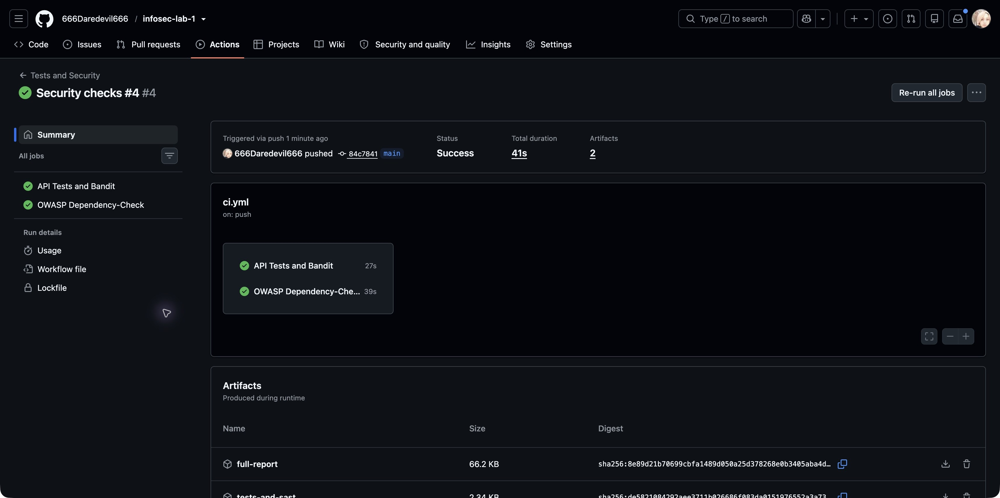
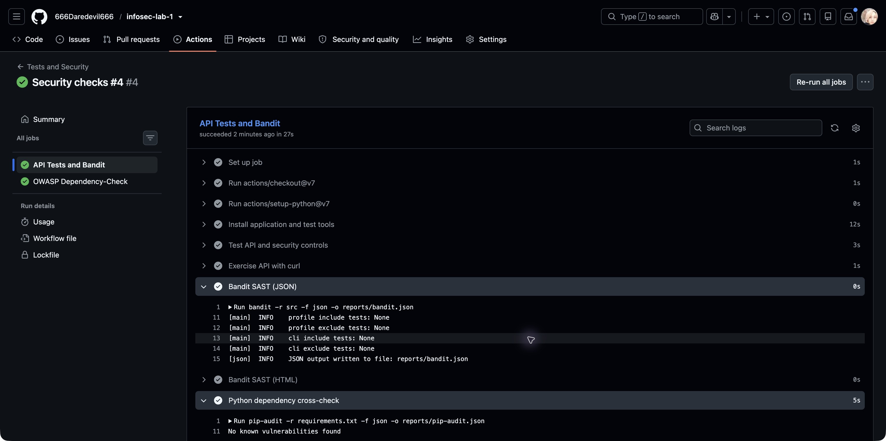
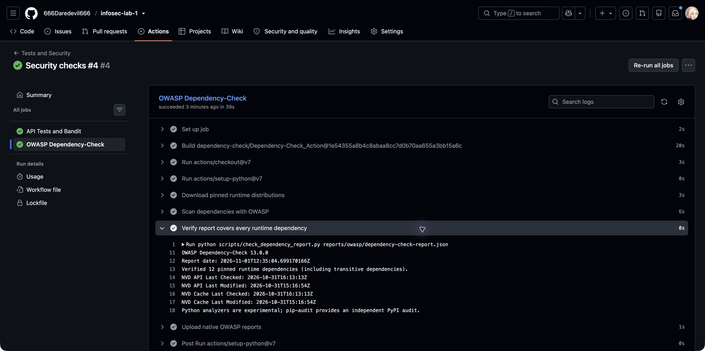

# Лабораторная работа №1 — защищённый REST API

[](https://github.com/666Daredevil666/infosec-lab-1/actions/workflows/ci.yml)

Python 3.13, Flask, SQLite, Argon2id и JWT. Реализованы регистрация, вход и получение данных с проверкой токена. GitHub Actions проверяет API, исходный код и зависимости при каждом push и pull request.

## Запуск

```sh
git clone https://github.com/666Daredevil666/infosec-lab-1.git
cd infosec-lab-1
python3 -m venv .venv
source .venv/bin/activate
python -m pip install -r requirements-dev.txt
python -m pip install --no-deps -e .
python scripts/run.py
```

Адрес: `http://127.0.0.1:8080`. При запуске создаётся SQLite-база; пароли хранятся только как Argon2id-хэши. `run.py` генерирует случайный ключ JWT в памяти, поэтому после перезапуска ранее выданные токены недействительны. Для постоянного ключа задайте `JWT_SECRET` (не менее 32 байт), для другого пути к БД — `API_DATABASE`. Ключи, базы и `.env` исключены из Git.

## API

| Метод | Путь | Назначение | Ответ |
|---|---|---|---|
| POST | `/auth/register` | Регистрация пользователя | 201; повтор логина — 409 |
| POST | `/auth/login` | Проверка пароля и выдача JWT | 200; неверные данные — 401 |
| GET | `/api/data` | Данные аутентифицированного пользователя | 200; без корректного JWT — 401 |

POST-запросы принимают JSON с полями `login` и `password`. Логин — 1–80 символов, без внешних пробелов и управляющих символов; пароль — 12–128 символов. Максимальный размер тела запроса — 16 KiB.

Регистрация:

```sh
curl -i http://127.0.0.1:8080/auth/register \
  -H 'Content-Type: application/json' \
  --data '{"login":"student","password":"Demo-password-2026!"}'
```

Вход и получение данных:

```sh
TOKEN=$(curl -fsS http://127.0.0.1:8080/auth/login \
  -H 'Content-Type: application/json' \
  --data '{"login":"student","password":"Demo-password-2026!"}' \
  | python -c 'import json,sys; print(json.load(sys.stdin)["access_token"])')
curl -i http://127.0.0.1:8080/api/data \
  -H "Authorization: Bearer $TOKEN"
unset TOKEN
```

Без токена `curl -i http://127.0.0.1:8080/api/data` возвращает 401. Успешный вход возвращает `access_token`, `token_type: Bearer`, `expires_in: 900`.

## Реализованные меры защиты

| Требование | Реализация |
|---|---|
| SQL Injection | Значения передаются в параметризованные SQLite-запросы через `?`; конкатенации SQL с вводом пользователя нет. |
| XSS | Логин экранируется `markupsafe.escape` перед возвратом. Ответы имеют тип `application/json`, заголовки `nosniff` и CSP. Клиент должен выводить данные безопасно, например через `textContent`. |
| Хранение паролей | Argon2id со случайной солью; проверка через `verify`, обновление параметров хэша через `check_needs_rehash`. Хэш не возвращается в API. |
| Аутентификация | JWT HS256. Middleware проверяет подпись, алгоритм, `sub`, `iat`, `exp`, `iss`, `aud` и существование пользователя в БД. Срок действия — 15 минут. |
| Проверка ввода | Проверяются Content-Type, структура JSON, типы, длины и размер запроса. HTTP-ошибки возвращаются в JSON. |
| Ошибки входа | Неизвестный логин и неверный пароль дают одинаковый ответ. Для неизвестного пользователя проверяется фиктивный хэш. |
| Кэширование | Ответы имеют `Cache-Control: no-store`. |

## Проверки и отчёты

Workflow: [`.github/workflows/ci.yml`](.github/workflows/ci.yml). Две задачи работают независимо:

- **API Tests and Bandit** — 23 теста, реальные запросы curl, Bandit SAST и дополнительный аудит Python-зависимостей через pip-audit.
- **OWASP Dependency-Check** — SCA для 12 закреплённых runtime-зависимостей, включая транзитивные. Находка с CVSS ≥ 7 завершает задачу ошибкой.

| Артефакт в Actions | Содержимое |
|---|---|
| `full-report` | Штатный `dependency-check-report.html`, JSON, XML, CSV, SARIF, JUnit и другие форматы OWASP. |
| `tests-and-sast` | `bandit.html`, `bandit.json`, `pip-audit.json`, `pytest.xml`, `curl-demo.txt`. |

Локальное воспроизведение проверок:

```sh
mkdir -p reports
python -m pytest -v --junitxml=reports/pytest.xml
python scripts/demo.py
bandit -r src -f json -o reports/bandit.json
bandit -r src -f html -o reports/bandit.html
pip-audit -r requirements.txt -f json -o reports/pip-audit.json
```

`demo.py` запускает временный сервер на свободном порту `127.0.0.1`, проверяет HTTP-коды 401/201/409/401/200/200 и завершает сервер. Временная БД удаляется, токен в журнале скрывается.

## Результаты GitHub Actions

Проверка 01.11.2026: [Security checks #4](https://github.com/666Daredevil666/infosec-lab-1/actions/runs/41307137208), commit `84c7841`. Обе задачи завершились успешно. [Последние успешные запуски](https://github.com/666Daredevil666/infosec-lab-1/actions/workflows/ci.yml?query=branch%3Amain+is%3Asuccess).

| Проверка | Результат |
|---|---|
| pytest | 23 теста пройдены |
| curl | Подтверждены ответы 401/201/409/401/200/200 |
| Bandit 1.9.4 | 0 находок |
| pip-audit 2.10.1 | 12 runtime-пакетов, 0 известных уязвимостей |
| OWASP Dependency-Check 13.0.0 | 12 пакетов, 0 активных CVE |







## Документация инструментов

- [Flask](https://flask.palletsprojects.com/en/stable/)
- [Argon2-cffi](https://argon2-cffi.readthedocs.io/en/stable/howto.html)
- [PyJWT](https://pyjwt.readthedocs.io/en/stable/usage.html)
- [Bandit](https://bandit.readthedocs.io/)
- [OWASP Dependency-Check](https://dependency-check.github.io/DependencyCheck/)
